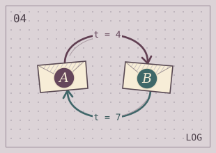
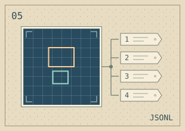
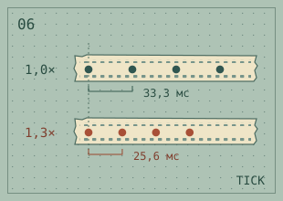
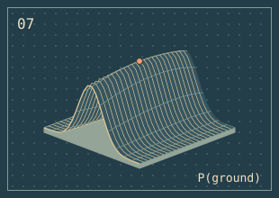
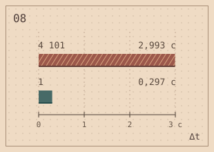
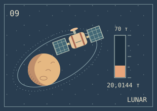

<a href="exhibits/lighthouse.stl">
  <picture>
    <source media="(max-width: 680px) and (prefers-reduced-motion: no-preference)" srcset="assets/postcard-compact-beam.svg">
    <source media="(max-width: 680px)" srcset="assets/postcard-compact.svg">
    <source media="(prefers-reduced-motion: no-preference)" srcset="assets/postcard-beam.svg">
    
  </picture>
</a>

# Портфолио overbaffe1

Я пишу на Python: строю 3D-сцены, разбираю журналы ИИ-агентов и готовлю данные для роботов. В альбоме девять работ. Вместо списка технологий у каждой — вещь, которую можно повернуть, измерить или проверить по исходнику.

**Указатель:** [01–02 · Графика](#01--маяк-на-слайде) · [03–04 · Агенты](#03--когда-ии-подменяет-номер) · [05–06 · Роботы](#05--четыре-вопроса-к-одному-кадру) · [07–08 · Вычисления](#07--рельеф-вероятности) · [09 · Орбита](#09--баланс-орбитальной-заправки)

## 01 · Маяк на слайде

<a href="exhibits/lighthouse.stl"></a>

В **[MyWorkAiBrain](https://github.com/overbaffe1/MyWorkAiBrain)** я собираю презентации кодом. В «Трёх чудесах» луч обходит горизонт, волна добегает до острова, а над башней летит чайка. Это не видео: [скрипт на Python](https://github.com/overbaffe1/MyWorkAiBrain/blob/4131aaf20ce8aa92066aaab203ee7a465cad6d91/presentations/wow/models/make_models.py) строит сцену в Blender, а сборщик встраивает анимированную glTF-модель в PowerPoint.

**[Повернуть маяк на GitHub →](exhibits/lighthouse.stl)** — здесь слепок без цвета и анимации. Чтобы увидеть маяк в движении, [скачай «Три чуда» (.pptx)](https://github.com/overbaffe1/MyWorkAiBrain/raw/refs/heads/main/exports/wow-3d-wonders.pptx) и запусти показ в PowerPoint с поддержкой 3D.<br clear="right">

## 02 · Восемь граней внутри README

<a href="https://github.com/overbaffe1/gitEdit#покрути-кристалл"></a>

**[gitEdit](https://github.com/overbaffe1/gitEdit)** — моя мастерская оформления на GitHub. Один из опытов: вместо картинки положить в Markdown координаты восьми треугольников. GitHub сам собирает из них кристалл, и читатель может рассмотреть его с обратной стороны.

<details>
<summary>Развернуть лист и покрутить кристалл</summary>

Потяни модель мышью или пальцем. Если просмотрщик не загрузился, [открой исходный STL](https://github.com/overbaffe1/gitEdit/blob/main/atlas/samples/crystal.stl).

```stl
solid field_crystal
  facet normal 0.5906538 0.7269586 0.3502274
    outer loop
      vertex 3 -1 36
      vertex 16 0 12
      vertex 0 13 12
    endloop
  endfacet
  facet normal 0.4731097 0.5822889 -0.6611405
    outer loop
      vertex -2 1 0
      vertex 0 13 12
      vertex 16 0 12
    endloop
  endfacet
  facet normal -0.5568154 0.6853112 0.4693668
    outer loop
      vertex 3 -1 36
      vertex 0 13 12
      vertex -16 0 12
    endloop
  endfacet
  facet normal -0.5236315 0.6444695 -0.5571976
    outer loop
      vertex -2 1 0
      vertex -16 0 12
      vertex 0 13 12
    endloop
  endfacet
  facet normal -0.5713854 -0.7032436 0.4230450
    outer loop
      vertex 3 -1 36
      vertex -16 0 12
      vertex 0 -13 12
    endloop
  endfacet
  facet normal -0.4923218 -0.6059346 -0.6248700
    outer loop
      vertex -2 1 0
      vertex 0 -13 12
      vertex -16 0 12
    endloop
  endfacet
  facet normal 0.6024457 -0.7414717 0.2954301
    outer loop
      vertex 3 -1 36
      vertex 0 -13 12
      vertex 16 0 12
    endloop
  endfacet
  facet normal 0.4435471 -0.5459041 -0.7108127
    outer loop
      vertex -2 1 0
      vertex 16 0 12
      vertex 0 -13 12
    endloop
  endfacet
endsolid field_crystal
```

Тот же кристалл можно собрать из бумаги: на [выкройке](https://github.com/overbaffe1/gitEdit/blob/f526b085fad262f932d483bde2571ce4dc0e8c44/assets/night-shift/crystal-net.svg) пунктиром отмечены сгибы, буквами — парные швы.

</details>
<br clear="right">

## 03 · Когда ИИ подменяет номер

<a href="https://github.com/overbaffe1/Guardian-of-Truth/blob/7def70e18a9b3398536575eb3245c97877362089/tests/test_signals.py#L50-L59"></a>

**[Guardian-of-Truth](https://github.com/overbaffe1/Guardian-of-Truth)** сверяет ответ ИИ-агента с контекстом, который тот действительно видел. Явные расхождения ловят правила, а для неоднозначных случаев есть языковая модель-судья.

В одном из тестов клиент назвал бронь `EHGLP3`. Инструмент подтвердил тот же номер. Следующим ходом агент меняет класс перелёта для `ZZ9ZZZ`. Нужна ли вторая модель, чтобы заметить ошибку?

<details>
<summary>Сверить ответ с тестом</summary>

Нет. Номер `ZZ9ZZZ` не приходил ни от клиента, ни от инструмента. Правило помечает аргумент вызова как `ungrounded_argument` — это жёсткий сигнал, который можно получить без GPU. [Вот проверка в десяти строках Python.](https://github.com/overbaffe1/Guardian-of-Truth/blob/7def70e18a9b3398536575eb3245c97877362089/tests/test_signals.py#L50-L59)

</details>
<br clear="right">

## 04 · Когда двое ждут друг друга

<a href="https://github.com/overbaffe1/Coordination-Referee/blob/72593fec80e6d42e4046d29ca7d84e95838d8835/sol/localize.py#L78-L90"></a>

В **[Coordination-Referee](https://github.com/overbaffe1/Coordination-Referee)** разбираю уже не одну реплику, а журнал целой команды агентов. По сообщениям и изменениям общего состояния модель различает нормальный прогон и шесть видов сбоев; отдельная функция находит ход, с которого началась проблема.

**Задача с марки:** на ходу 4 агент A ждёт B, на ходу 7 агент B ждёт A. Если тип сбоя уже известен — `deadlock`, какой ход отметит локализатор?

<details>
<summary>Проверить по коду</summary>

**Ход 4.** В этом примере пара всего одна. [Правило локализации](https://github.com/overbaffe1/Coordination-Referee/blob/72593fec80e6d42e4046d29ca7d84e95838d8835/sol/localize.py#L78-L90) находит ожидания в обе стороны и возвращает первое по времени сообщение пары. Это иллюстрация правила, не запись из обучающего набора.

</details>
<br clear="right">

## 05 · Четыре вопроса к одному кадру

<a href="https://github.com/overbaffe1/Vision-Action-Data-Factory/blob/afe7ed98c7f7db8efc27c06201b455788163a07a/annotations.jsonl#L1-L4"></a>

**[Vision-Action-Data-Factory](https://github.com/overbaffe1/Vision-Action-Data-Factory)** превращает записи о движениях робота в учебные диалоги. Для первого кадра эпизода с заданием «положить банку супа в корзину» получились четыре разных вопроса: что в сцене, что делать дальше, где объект и какое действие выполняется сейчас.

[Прочитать четыре записи JSONL](https://github.com/overbaffe1/Vision-Action-Data-Factory/blob/afe7ed98c7f7db8efc27c06201b455788163a07a/annotations.jsonl#L1-L4) · [Сверить объём демонабора](https://github.com/overbaffe1/Vision-Action-Data-Factory/blob/afe7ed98c7f7db8efc27c06201b455788163a07a/annotations.stats.json): 3 эпизода → 23 отобранных кадра → 92 пары «вопрос — ответ».<br clear="right">

## 06 · Один план в двух темпах

<a href="https://github.com/overbaffe1/Green-Challenge/blob/5e27768309ef18f0422b218d5daee9f3778198f4/tests/test_feed.py#L43-L56"></a>

В **[Green-Challenge](https://github.com/overbaffe1/Green-Challenge)** модель GreenVLA предоставили организаторы. Моя часть — слой между её прогнозом и симулятором: он решает, *когда* исполнить каждую строку плана. При переходе с 1× на 1,3× интервал между строками сокращается с 33,3 до 25,6 мс, но формат ответа симулятору не меняется.

[В CPU-тесте на двух скоростях](https://github.com/overbaffe1/Green-Challenge/blob/5e27768309ef18f0422b218d5daee9f3778198f4/tests/test_feed.py#L43-L56) оба ответа содержат по 20 команд. Это проверка расписания, а не замер скорости реального робота.<br clear="right">

## 07 · Рельеф вероятности

<a href="exhibits/qaoa-relief.stl"></a>

В **[QAOA](https://github.com/overbaffe1/QAOA)** подбираю пять пар углов для схемы из 12 кубитов. Цель — повысить вероятность получить состояние с наименьшей энергией. Для этого оттиска взял [строку `id=0` из таблицы углов](https://github.com/overbaffe1/QAOA/blob/a993143505f1889075c57f663c06c4f5a79722cc/merged2.csv). Первые четыре пары зафиксировал, последнюю менял по двум осям. Чем выше точка, тем больше вероятность.

В центре — исходные углы: вероятность около 47% для одной задачи, не среднее по всем 500. **[Повернуть рельеф на GitHub →](exhibits/qaoa-relief.stl)** · [Как он рассчитан](exhibits/README.md#как-построен-рельеф).<br clear="right">

## 08 · Один токен вместо 4 101

<a href="https://github.com/overbaffe1/3D-DIT-Distillation/blob/d65823d79066eb6e67a722d8a3db2f4153739ac7/fetched_info/solver_experiments.json#L2-L12"></a>

В **[3D-DIT-Distillation](https://github.com/overbaffe1/3D-DIT-Distillation)** ускоряю генерацию формы в Kandinsky3D. В проходе без подсказки модель обрабатывала 4 101 одинаковый токен контекста. Здесь достаточно одного: не приходится повторять одну и ту же работу тысячи раз.

[Замер этого прохода](https://github.com/overbaffe1/3D-DIT-Distillation/blob/d65823d79066eb6e67a722d8a3db2f4153739ac7/fetched_info/solver_experiments.json#L2-L12): **2,993 с → 0,297 с**, максимальное расхождение выходов — около 3,2 × 10⁻⁶. Это сравнение одной ветви вычислений, не ускорение всей генерации. [Как сравниваются выходы в тесте](https://github.com/overbaffe1/3D-DIT-Distillation/blob/d65823d79066eb6e67a722d8a3db2f4153739ac7/tools/test_solution.py#L135-L166).<br clear="right">

## 09 · Баланс орбитальной заправки

<a href="https://github.com/overbaffe1/CosmoH/blob/828e19eca78b6392da9610b2c04f20fcc199094a/solutions/fuel-contour/docs/evidence/BALANCE.md"></a>

**[CosmoH](https://github.com/overbaffe1/CosmoH)** — командный проект «Ленивых в орбите». В учебном планировщике на 2035–2040 годы сравниваем схемы снабжения космической заправки: сколько привезти, сколько оставить в резерве и что произойдёт при срыве поставки. [Решение в десяти слайдах (PDF)](https://github.com/overbaffe1/CosmoH/blob/828e19eca78b6392da9610b2c04f20fcc199094a/solutions/fuel-contour/docs/PRESENTATION.pdf).

<details>
<summary>Сверить один день без планировщика</summary>

В начале дня на складе **20 т**. В базовом сценарии Lunar принято 0,301973 т, потеряно 0,013589 т и выдано клиентам 0,273973 т. После вычитания потерь и выдачи осталось **около 20,0144 т**. [Строка расчёта до округления](https://github.com/overbaffe1/CosmoH/blob/828e19eca78b6392da9610b2c04f20fcc199094a/solutions/fuel-contour/docs/evidence/balance-example.json) — это проверка модели, не измерение на настоящей станции.

</details>
<br clear="right">

## На обороте

**Форк:** [deepseek-harness](https://github.com/overbaffe1/deepseek-harness) — копия [проекта DeepSeek AI](https://github.com/deepseek-ai/deepseek-harness), среды для ИИ-агентов на основе плагинов. Это не одна из девяти работ альбома.

**Сам альбом:** в [overbaffe1/overbaffe1](https://github.com/overbaffe1/overbaffe1) лежат рисунки, 3D-экспонаты и [скрипт, который печатает обложку](tools/print_album.py).

---

**[Все мои репозитории →](https://github.com/overbaffe1?tab=repositories)** · [Об обложке и экспонатах](exhibits/README.md)
