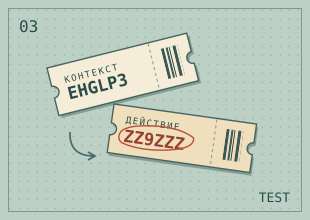

<a href="exhibits/lighthouse.stl">
  <picture>
    <source media="(max-width: 680px) and (prefers-reduced-motion: no-preference)" srcset="assets/postcard-compact-beam.svg">
    <source media="(max-width: 680px)" srcset="assets/postcard-compact.svg">
    <source media="(prefers-reduced-motion: no-preference)" srcset="assets/postcard-beam.svg">
    
  </picture>
</a>

# Портфолио overbaffe1

Я пишу на Python: строю сцены для Blender и проверяю ответы ИИ-агентов. А в gitEdit собираю способы показать работу прямо на GitHub. В этот альбом отобрал три образца — у каждого можно открыть и результат, и исходник.

## 01 · Маяк на слайде

<a href="exhibits/lighthouse.stl"></a>

В **[MyWorkAiBrain](https://github.com/overbaffe1/MyWorkAiBrain)** я собираю презентации кодом. В «Трёх чудесах» луч обходит горизонт, волна добегает до острова, а над башней летит чайка. Это не видео: Python строит сцену в Blender, а сборщик встраивает анимированную glTF-модель в PowerPoint.

**[Повернуть маяк на GitHub →](exhibits/lighthouse.stl)** — здесь слепок без цвета и анимации. Чтобы увидеть маяк в движении, [скачай «Три чуда» (.pptx)](https://github.com/overbaffe1/MyWorkAiBrain/raw/refs/heads/main/exports/wow-3d-wonders.pptx) и запусти показ в PowerPoint с поддержкой 3D.

## 02 · Восемь граней внутри README

<a href="https://github.com/overbaffe1/gitEdit#покрути-кристалл"></a>

**[gitEdit](https://github.com/overbaffe1/gitEdit)** — моя мастерская оформления на GitHub. Один из опытов: вместо картинки положить в Markdown координаты восьми треугольников. GitHub сам собирает из них кристалл, и читатель может рассмотреть его с обратной стороны.

<details>
<summary>Развернуть лист и покрутить кристалл</summary>

Потяни модель мышью или пальцем. Если просмотрщик не загрузился, [открой исходный STL](https://github.com/overbaffe1/gitEdit/blob/main/atlas/samples/crystal.stl).

```stl
solid field_crystal
  facet normal 0.5906538 0.7269586 0.3502274
    outer loop
      vertex 3 -1 36
      vertex 16 0 12
      vertex 0 13 12
    endloop
  endfacet
  facet normal 0.4731097 0.5822889 -0.6611405
    outer loop
      vertex -2 1 0
      vertex 0 13 12
      vertex 16 0 12
    endloop
  endfacet
  facet normal -0.5568154 0.6853112 0.4693668
    outer loop
      vertex 3 -1 36
      vertex 0 13 12
      vertex -16 0 12
    endloop
  endfacet
  facet normal -0.5236315 0.6444695 -0.5571976
    outer loop
      vertex -2 1 0
      vertex -16 0 12
      vertex 0 13 12
    endloop
  endfacet
  facet normal -0.5713854 -0.7032436 0.4230450
    outer loop
      vertex 3 -1 36
      vertex -16 0 12
      vertex 0 -13 12
    endloop
  endfacet
  facet normal -0.4923218 -0.6059346 -0.6248700
    outer loop
      vertex -2 1 0
      vertex 0 -13 12
      vertex -16 0 12
    endloop
  endfacet
  facet normal 0.6024457 -0.7414717 0.2954301
    outer loop
      vertex 3 -1 36
      vertex 0 -13 12
      vertex 16 0 12
    endloop
  endfacet
  facet normal 0.4435471 -0.5459041 -0.7108127
    outer loop
      vertex -2 1 0
      vertex 16 0 12
      vertex 0 -13 12
    endloop
  endfacet
endsolid field_crystal
```

</details>

## 03 · Когда ИИ подменяет номер

<a href="https://github.com/overbaffe1/Guardian-of-Truth/blob/7def70e18a9b3398536575eb3245c97877362089/tests/test_signals.py#L50-L59"></a>

**[Guardian-of-Truth](https://github.com/overbaffe1/Guardian-of-Truth)** сверяет ответ ИИ-агента с контекстом, который тот действительно видел. Явные расхождения ловят правила, а для неоднозначных случаев есть языковая модель-судья.

В одном из тестов клиент назвал бронь `EHGLP3`. Инструмент подтвердил тот же номер. Следующим ходом агент меняет класс перелёта для `ZZ9ZZZ`. Нужна ли вторая модель, чтобы заметить ошибку?

<details>
<summary>Сверить ответ с тестом</summary>

Нет. Номер `ZZ9ZZZ` не приходил ни от клиента, ни от инструмента. Правило помечает аргумент вызова как `ungrounded_argument` — это жёсткий сигнал, который можно получить без GPU. [Вот проверка в десяти строках Python.](https://github.com/overbaffe1/Guardian-of-Truth/blob/7def70e18a9b3398536575eb3245c97877362089/tests/test_signals.py#L50-L59)

</details>

---

**[Все мои репозитории →](https://github.com/overbaffe1?tab=repositories)** · [Об обложке и экспонатах](exhibits/README.md)
