<a href="exhibits/lighthouse.stl">
  <picture>
    <source media="(max-width: 680px) and (prefers-reduced-motion: no-preference)" srcset="assets/postcard-compact-beam.svg">
    <source media="(max-width: 680px)" srcset="assets/postcard-compact.svg">
    <source media="(prefers-reduced-motion: no-preference)" srcset="assets/postcard-beam.svg">
    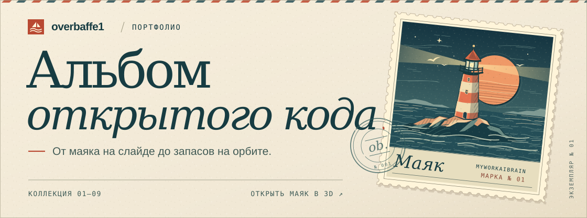
  </picture>
</a>

# Портфолио overbaffe1

Я пишу на Python: строю 3D-сцены, разбираю журналы ИИ-агентов и участвую в хакатонах пока учусь в магистратуре.

**В альбоме:** [01 · Маяк](#01--маяк-на-слайде) · [02 · Кристалл](#02--восемь-граней-внутри-readme) · [03–11 · Хакатоны](#участие-в-хакатонах)

## 01 · Маяк на слайде

<a href="exhibits/lighthouse.stl">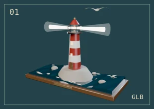</a>

В **[MyWorkAiBrain](https://github.com/overbaffe1/MyWorkAiBrain)** я собираю презентации кодом. В «Трёх чудесах» луч обходит горизонт, волна добегает до острова, а над башней летит чайка. Это не видео: [скрипт на Python](https://github.com/overbaffe1/MyWorkAiBrain/blob/4131aaf20ce8aa92066aaab203ee7a465cad6d91/presentations/wow/models/make_models.py) строит сцену в Blender, а сборщик встраивает анимированную glTF-модель в PowerPoint.

**[Повернуть маяк на GitHub →](exhibits/lighthouse.stl)** — здесь слепок без цвета и анимации. Чтобы увидеть маяк в движении, [скачай «Три чуда» (.pptx)](https://github.com/overbaffe1/MyWorkAiBrain/raw/refs/heads/main/exports/wow-3d-wonders.pptx) и запусти показ в PowerPoint с поддержкой 3D.<br clear="right">

## 02 · Восемь граней внутри README

<a href="https://github.com/overbaffe1/gitEdit#покрути-кристалл">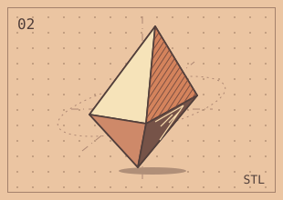</a>

**[gitEdit](https://github.com/overbaffe1/gitEdit)** — моя мастерская оформления на GitHub. Один из опытов: вместо картинки положить в Markdown координаты восьми треугольников. GitHub сам собирает из них кристалл, и читатель может рассмотреть его с обратной стороны.

<details>
<summary>Развернуть лист и покрутить кристалл</summary>

Потяни модель мышью или пальцем. Если просмотрщик не загрузился, [открой исходный STL](https://github.com/overbaffe1/gitEdit/blob/main/atlas/samples/crystal.stl).

```stl
solid field_crystal
  facet normal 0.5906538 0.7269586 0.3502274
    outer loop
      vertex 3 -1 36
      vertex 16 0 12
      vertex 0 13 12
    endloop
  endfacet
  facet normal 0.4731097 0.5822889 -0.6611405
    outer loop
      vertex -2 1 0
      vertex 0 13 12
      vertex 16 0 12
    endloop
  endfacet
  facet normal -0.5568154 0.6853112 0.4693668
    outer loop
      vertex 3 -1 36
      vertex 0 13 12
      vertex -16 0 12
    endloop
  endfacet
  facet normal -0.5236315 0.6444695 -0.5571976
    outer loop
      vertex -2 1 0
      vertex -16 0 12
      vertex 0 13 12
    endloop
  endfacet
  facet normal -0.5713854 -0.7032436 0.4230450
    outer loop
      vertex 3 -1 36
      vertex -16 0 12
      vertex 0 -13 12
    endloop
  endfacet
  facet normal -0.4923218 -0.6059346 -0.6248700
    outer loop
      vertex -2 1 0
      vertex 0 -13 12
      vertex -16 0 12
    endloop
  endfacet
  facet normal 0.6024457 -0.7414717 0.2954301
    outer loop
      vertex 3 -1 36
      vertex 0 -13 12
      vertex 16 0 12
    endloop
  endfacet
  facet normal 0.4435471 -0.5459041 -0.7108127
    outer loop
      vertex -2 1 0
      vertex 16 0 12
      vertex 0 -13 12
    endloop
  endfacet
endsolid field_crystal
```

Тот же кристалл можно собрать из бумаги: на [выкройке](https://github.com/overbaffe1/gitEdit/blob/f526b085fad262f932d483bde2571ce4dc0e8c44/assets/night-shift/crystal-net.svg) пунктиром отмечены сгибы, буквами — парные швы.

</details>
<br clear="right">

## Участие в хакатонах

<h3 align="center"><picture>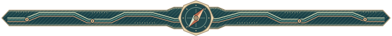</picture><br><a href="https://dsworks.ru/group/aij2026">AI Journey Contest 2026</a></h3>

<p align="center">
  <a href="https://github.com/overbaffe1/Guardian-of-Truth"><picture>
    <source media="(prefers-reduced-motion: no-preference)" srcset="assets/hackathons/03-guardian.svg">
    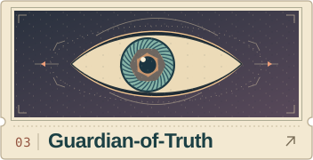
  </picture></a>
  <a href="https://github.com/overbaffe1/Coordination-Referee"><picture>
    <source media="(prefers-reduced-motion: no-preference)" srcset="assets/hackathons/04-referee.svg">
    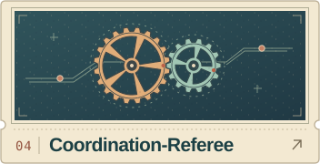
  </picture></a>
  <a href="https://github.com/overbaffe1/Vision-Action-Data-Factory"><picture>
    <source media="(prefers-reduced-motion: no-preference)" srcset="assets/hackathons/05-film.svg">
    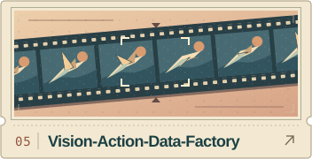
  </picture></a>
  <a href="https://github.com/overbaffe1/Green-Challenge"><picture>
    <source media="(prefers-reduced-motion: no-preference)" srcset="assets/hackathons/06-arm.svg">
    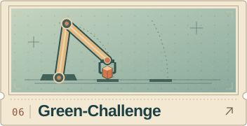
  </picture></a>
  <a href="https://github.com/overbaffe1/3D-DIT-Distillation"><picture>
    <source media="(prefers-reduced-motion: no-preference)" srcset="assets/hackathons/08-voxels.svg">
    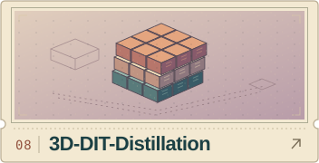
  </picture></a>
</p>

<h3 align="center"><picture>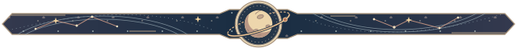</picture><br>КосмоХакатон 2026</h3>

<p align="center">
  <a href="https://github.com/overbaffe1/CosmoH"><picture>
    <source media="(prefers-reduced-motion: no-preference)" srcset="assets/hackathons/09-orbit.svg">
    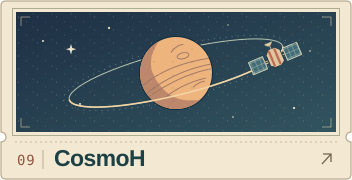
  </picture></a>
  <a href="https://github.com/overbaffe1/AUSG"><picture>
    <source media="(prefers-reduced-motion: no-preference)" srcset="assets/hackathons/10-contact.svg">
    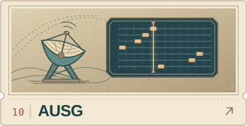
  </picture></a>
  <a href="https://github.com/overbaffe1/OMLP"><picture>
    <source media="(prefers-reduced-motion: no-preference)" srcset="assets/hackathons/11-atlas.svg">
    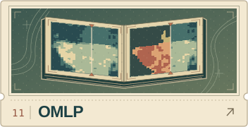
  </picture></a>
</p>

<h3 align="center"><picture>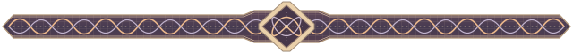</picture><br><a href="https://aiijc.com/ru/">AI Challenge 2026</a></h3>

<p align="center">
  <a href="https://github.com/overbaffe1/QAOA"><picture>
    <source media="(prefers-reduced-motion: no-preference)" srcset="assets/hackathons/07-relief.svg">
    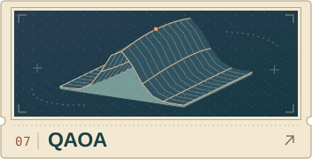
  </picture></a>
</p>

## На обороте

**Форк:** [deepseek-harness](https://github.com/overbaffe1/deepseek-harness) — копия [проекта DeepSeek AI](https://github.com/deepseek-ai/deepseek-harness), среды для ИИ-агентов на основе плагинов.

**Сам альбом:** в [overbaffe1/overbaffe1](https://github.com/overbaffe1/overbaffe1) лежат рисунки, 3D-экспонаты и [скрипт, который печатает обложку](tools/print_album.py).

---

**[Все мои репозитории →](https://github.com/overbaffe1?tab=repositories)** · [Об обложке и экспонатах](exhibits/README.md)
